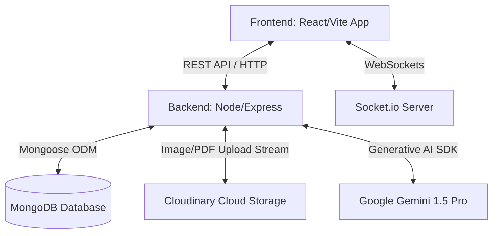

# SmartSikshak Architecture & Gemini Evaluation Guide

## 1. Overview
SmartSikshak is a comprehensive Enterprise Resource Planning (ERP) system tailored for Colleges and Schools. It provides robust dashboards for both Students and Teachers, integrating modern web technologies with AI-powered assignment evaluation capabilities.

## 2. Technology Stack

### Frontend Stack
- **Framework**: React 18 with Vite for fast builds and hot module replacement.
- **Styling**: Tailwind CSS for utility-first styling, paired with Radix UI components (headless UI) to ensure accessibility and consistent design.
- **State Management**: Redux Toolkit & React-Redux for global state, with `redux-persist` for local storage caching.
- **Routing**: React Router DOM (v7) for client-side navigation.
- **Other Tools**: Framer Motion (animations), Axios (HTTP requests), React Hook Form & Zod (form validation and schemas), Recharts (data visualization).

### Backend Stack
- **Runtime & Framework**: Node.js and Express.js (v5).
- **Database**: MongoDB with Mongoose ODM for structured data models.
- **Real-Time**: Socket.io for live communication (e.g., chat, doubt discussions, live notifications).
- **File Storage**: Cloudinary for storing assignment PDFs and media.
- **Authentication**: JWT (JSON Web Tokens) with cookie-parser for secure, stateful sessions.
- **AI Integration**: Google Generative AI SDK (`@google/generative-ai`) for automated AI assignment grading.

## 3. Core Modules & Features

### 👨‍🎓 Student Module
- **Dashboard**: Central hub for all student activities.
- **Academics**: Study Material, Progress Reports, Weekly Timetable.
- **Engagement**: Class Recordings, Doubts and Discussions.
- **Assessments**: Assignment management and AI-generated assessments.
- **Attendance**: Subject-wise and overall attendance tracking.

### 👩‍🏫 Teacher Module
- **Dashboard**: Administrative view for teachers.
- **Management**: Create Classes, Register Students/Teachers, Create Timetables.
- **Assessments**: Manage assignments, view submissions, and trigger AI assessments.
- **Tracking**: Teacher attendance, student attendance tracking.

---

## 4. System Architecture



---

## 5. AI Evaluation Architecture (Gemini API Integration)

One of the standout features of SmartSikshak is the automated AI evaluation of student assignment submissions using Google's Gemini 1.5 Pro model. 

### The Evaluation Workflow
When a teacher initiates an assignment evaluation, the backend follows a strict pipeline defined in `AssignmentController.js`:

1. **Fetch Assignment Details**: The backend retrieves the assignment document and the teacher's original questions from MongoDB.
2. **Download PDF**: The student's submitted assignment PDF is fetched securely from **Cloudinary** into a memory buffer.
3. **Parse PDF Content**: The `pdf-parse` library extracts raw text from the binary PDF buffer.
4. **Extract Answers**: A custom parser scans the text for specific patterns (e.g., lines starting with `Q1:`, `Q2:`) to reliably isolate the student's answers for each question.
5. **Pairing Q&A**: The system maps the Teacher's questions directly to the parsed Student answers.
6. **Prompt Generation**: The backend uses a dedicated prompt builder (`config/geminiPrompt.js`) to construct a strict instruction set for Gemini.
7. **Gemini API Call**: The system prompts **Gemini 1.5 Pro** to act as an expert evaluator and plagiarism checker. It is strictly instructed to return a pure JSON response containing scores (0-10), constructive feedback, and plagiarism levels (Low/Medium/High).
8. **Save & Return**: The generated JSON is parsed, saved into the MongoDB assignment document under the `evaluation` field, and returned to the frontend to be displayed.

### Example Gemini Prompt Structure
```text
You are an expert education evaluator and plagiarism checker. Analyze the following student assignment and evaluate each answer.

For each question, provide:
- Score (0-10)
- Constructive feedback
- Plagiarism analysis (level and reason)

Also provide a summary of the overall evaluation...
Respond ONLY in raw JSON format...
```

This strict JSON structure guarantees that the frontend can reliably map the AI's feedback directly into React components like charts, accordions, and scorecards.
